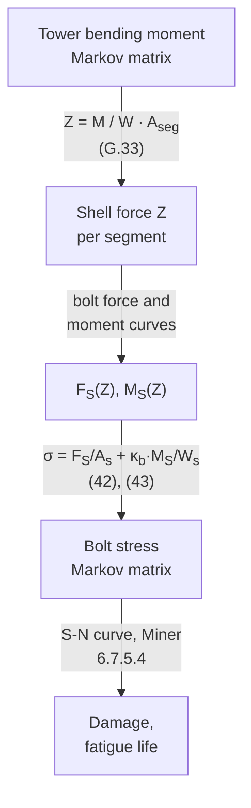

# Model overview

This page summarizes the model implemented by PyFlange and tells where each
part is found in the code and in the references. It is not a substitute for
IEC 61400-6 Annex G (ref. [2]) and its background documents (refs. [1] and
[5]), which give the full derivation.

## From tower loads to bolt fatigue

| Step | PyFlange |
|------|----------|
| Moment to shell force | [`bolt_markov_matrix`][pyflange.flangesegments.bolt_markov_matrix] |
| Bolt force and moment curves | [`PolynomialLFlangeSegment`][pyflange.flangesegments.PolynomialLFlangeSegment], [`PolynomialTFlangeSegment`][pyflange.flangesegments.PolynomialTFlangeSegment] |
| Bolt stress, S-N curve, damage | [`BoltFatigueAnalysis`][pyflange.fatigue.BoltFatigueAnalysis], [`BoltFatigueCurve`][pyflange.fatigue.BoltFatigueCurve] |

## The flange segment

The flange is divided into segments, each containing one bolt (L-flange) or
one pair of bolts (T-flange). A segment is loaded by the meridional shell
force **Z**, positive in tension. In the unloaded state the segment carries
the dead weight `Zg` (negative) and the bolt carries its preload. The
geometric parameters are shown in the [Nomenclature](nomenclature.md#geometry).

A **gap** between the two flanges, caused by flatness imperfections, is
described by its height, its angle and its shape
([`Gap`][pyflange.flangesegments.Gap]). Before the flanges are in full
contact, part of the external load is needed to close the gap, which makes
the bolt force increase faster than in a perfect flange.

## Bolt force curve

The bolt force FS(Z) is defined by four points (ref. [2],
Table G.1):

| Point | Meaning | PyFlange property |
|-------|---------|-------------------|
| P1 | Flange at rest: Z1 = dead weight, FS,1 = preload after losses | `shell_force_at_rest`, `bolt_force_at_rest` |
| P2 | Ultimate tensile state | `shell_force_at_tensile_ULS`, `bolt_force_at_tensile_ULS` |
| P3 | Small displacement: sets the initial slope of the curve | `shell_force_at_small_displacement`, `bolt_force_at_small_displacement` |
| P4 | Gap completely closed | `shell_force_at_closed_gap` |

- For Z ≥ Z1, FS is the quadratic polynomial through
  P1, P2 and P3 (ref. [2], eq. G.32).
- For Z4 < Z < Z1, it is a quadratic polynomial with
  the same slope at P1 and zero slope at P4.
- For Z ≤ Z4, it is constant.

The main ingredients of the points are:

- **Preload after losses** (ref. [2], 6.7.5.1): the preload `Fv` reduced by
  settlement (eqs. (27), (28)) and plastic strain (eq. (24)).
  Property `bolt_preload`.
- **Lever ratio and a'** (ref. [2], G.1.3; ref. [6]): the effective inner
  lever arm of an L-flange, with the action point correction of Tobinaga
  and Ishihara.
- **Gap stiffness** (ref. [2], eqs. G.41 to G.46): the shell stiffness
  kshell (simplified formula G.43, a value given by the user, or
  the FEA database of [`shell_stiffness`][pyflange.flangesegments.shell_stiffness])
  plus the flange bending stiffness kfl.
- **Gap closing force** ΔZgap (ref. [2], eqs. G.39, G.40), reduced
  by the **flange inclination** (ref. [2], G.2.4, eqs. G.66 to G.70) and,
  for T-flanges, increased by early prying (eqs. G.47, G.48).
- **Stiffness correction factor** αk (ref. [2], eqs. G.49 to
  G.52), which scales Z2 and Z3.
- The **gap shape factor** scales FS,2 − FS,1 and the
  initial slope, to represent gaps that are not sinusoidal (used in Monte
  Carlo simulations).

The values of all intermediate quantities are reported by
`pyflange determ` (see [JSON result files](../json-format.md#result-files)).

## Bolt bending moment

The bolt moment MS(Z) is computed from the rotation of the flange
at the bolt (ref. [2], G.2.3): eqs. G.59 and G.60 for L-flanges, which give
a quadratic curve in Z, and eqs. G.61 to G.63 for T-flanges, which give a
cubic curve. The compressive branch is built as for the bolt force.

## Validity of the model

The polynomial model is valid only when the flange fails in the intended
mode at the ultimate limit state (ref. [2], G.1.2 and G.2.1):

- **L-flanges**: failure mode B (bolt failure with plastic hinges in the
  flange and shell, eq. G.30);
- **T-flanges**: failure mode A (bolt failure, eq. G.31).

`failure_mode(fy_sh, fy_fl)` computes the ultimate shell force of the modes
A, B, D and E and returns the governing one; `validate(fy_sh, fy_fl)` raises
an error if it is not the required mode. PyFlange does **not** call
`validate` automatically: call it in your scripts.

Other limits of the model, given in ref. [2], are not checked by PyFlange,
for example the flatness tolerance of 1.4 mm/m for the analytical design gap
(6.7.5.2) and the conditions for the simplified plastic preload loss
(6.7.5.1.3, 6.7.5.1.4).

## Fatigue damage

The bolt stress range is the axial stress range plus the bending stress range
reduced by κb (ref. [2], eqs. (42), (43)), on the bolt stress
area. The S-N curve has detail category 50 MPa at 2·106 cycles,
slopes 3 and 5, knee point at 2·106 cycles, size reduction
ks (eq. (44)), γM = 1.1 and no endurance limit. The
damage is the Miner's sum; the allowable damage is 1.0 (6.7.5.4).

The stress ranges can be multiplied by a stress multiplication factor
(`SMF`), which represents the model uncertainty of the analytical model
(ref. [5], 6.5).

## ED2

The changes proposed for IEC 61400-6 ED2 (ref. [5], section 9.7) are
implemented in separate classes, which have the same interface as the AMD1
ones:

| # | Change | L-flange | T-flange |
|---|--------|----------|----------|
| 1 | Torsional correction factor fk,gap on the gap closing force | `PolynomialLFlangeSegmentED2` | not applicable |
| 2 | Gap stiffness: ftot applied to the shell stiffness only | `PolynomialLFlangeSegmentED2` | `PolynomialTFlangeSegmentED2` |
| 3 | Lower bound of a\* reduced from 0.4·a' to 0.3·a' | `PolynomialLFlangeSegmentED2` | not applicable |
| – | Weibull gap height distribution, 75% design fractile (ref. [5], 2.2.4) | `gap_height_distribution_ED2` | `gap_height_distribution_ED2` |

## Monte Carlo simulation

The probabilistic model of refs. [1] and [5] (section 6) treats preload,
preload losses, gap, flange inclination, fatigue loads, S-N curve, Miner's
rule and model uncertainty as random variables. PyFlange provides random
samplers for each of them in [`pyflange.stats`](../apis/stats.md); the
`sample` command and [`sample_fatiguecase`][pyflange.io.sample_fatiguecase]
combine them as described in the
[JSON format](../json-format.md#monte-carlo-model).

## Implementation notes

Where PyFlange deviates from the text of ref. [2], it does so to reproduce
the reference results it is validated against (see
[Validation](validation.md)), or because the standard leaves room for
interpretation. The notable cases are:

- **ftot for small gap angles.** For L-flanges, the gap stiffness
  factor ftot (eq. G.42) is further reduced by the factor
  min(αgap/30°, 1)², which only matters for gap angles below 30°,
  i.e. in Monte Carlo simulations.
- **Wall thickness.** The segment width and the shell parameters use the
  mean of the upper and lower wall thickness (`s_ratio`).
- **Tower section modulus.** The conversion from bending moment to shell
  force uses the section modulus at the shell mid-surface, which is slightly
  conservative.
- **Macro-geometric factor.** In `bolt_markov_matrix`, the
  `macro_geometric_factor` (SCF of 6.7.5.3) is applied to the dead weight as
  well as to the mean and range values.
- **T-flange bolt moment.** The tensile branch is the exact cubic of eq.
  G.61, while the SGRE reference workbooks fit a quadratic through three
  points (differences of about 1%).
